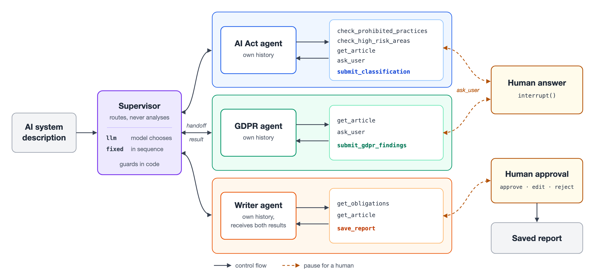

<div align="center">

# AI Act Compliance Agent

**Describe an AI system in plain language and get a first-pass EU AI Act and GDPR risk report.<br>The same agent is built four ways, and the single-agent and multi-agent versions are benchmarked on the same cases.**

</div>

---

## In short

- The agent labels a system `prohibited`, `high_risk`, `limited_risk` or `minimal_risk` and writes a Markdown report. A report is saved only after checks in code and human approval.
- **Multi-agent did not clearly beat single-agent:** 0.46 accuracy for one agent, 0.42 for a fixed multi-agent pipeline, 0.50 with LLM routing. On 26 cases, one case is about 4 points, so these gaps are small.
- **The clearest gain is asking for missing facts:** 5/6 underspecified cases got a question, against 0/6 for one agent. Accuracy on those cases barely moved (2/6 against 1/6).
- **LLM routing costs more:** 17.8 LLM calls per case against 10.9 for the fixed pipeline. It changed the outcome on 2 of 26 cases.
- **0** unknown articles in saved reports, in every version. Citations are checked in code, not in the prompt.

## Versions

| Version | Stack | What changes |
|---|---|---|
| [`v0_scratch`](v0_scratch/agent.py) | `ollama` client | Tool-calling loop written by hand |
| [`v1_langgraph`](v1_langgraph/agent.py) | LangGraph | Same agent as a graph, with checkpoints and `interrupt()` for human input |
| [`v2_mcp`](v2_mcp/) | FastMCP | Same graph, tools served over MCP |
| [`v3_multiagent`](v3_multiagent/agent.py) | LangGraph | A supervisor plus AI Act, GDPR and writer sub-agents, each with its own history |

<p align="center">
  
</p>

v3 has two routing modes. `fixed` always runs `ai_act -> gdpr -> writer`. `llm` lets the supervisor choose who works next.

Guards in code: no writer before a classification, no finish before a saved report unless the AI Act agent has given up, the saved category must match the classification, and budgets on handoffs, steps, nudges and questions.

## Results

26 synthetic cases, 6 of them underspecified. `qwen2.5:7b`, temperature 0. Raw output: [`eval/results_v3.json`](eval/results_v3.json).

| Metric | v1 | v3_fixed | v3_llm |
|---|---:|---:|---:|
| Accuracy | 0.46 | 0.42 | 0.50 |
| Macro-F1 | 0.45 | 0.47 | 0.54 |
| Reports produced | 24/26 | 21/26 | 23/26 |
| Citation precision / recall | 0.60 / 0.57 | 0.48 / 0.52 | 0.52 / 0.62 |
| GDPR flag precision / recall | 0.51 / 0.47 | 0.71 / 0.26 | 0.72 / 0.34 |
| Asked on underspecified cases | 0/6 | 5/6 | 5/6 |
| No question on complete cases | 20/20 | 15/20 | 12/20 |
| Unknown articles in saved reports | 0 | 0 | 0 |
| Tool error rate | 6.0% | 14.5% | 14.6% |
| Mean agent steps | 6.5 | 10.9 | 14.2 |
| Mean LLM calls | - | 10.9 | 17.8 |
| Mean handoffs | - | 2.6 | 3.6 |
| Mean latency | 112 s | 168 s | 239 s |

A case with no report counts as wrong. v0 and v1 give the same prediction on all 26 cases ([`eval/results.json`](eval/results.json)), and a v1 rerun reproduced them exactly, so only v1 is shown.

## What the benchmark showed

**LLM routing mattered only as a retry.** `v3_fixed` and `v3_llm` agree on 24 of 26 cases. `v3_fixed` lost 5 reports because the AI Act agent stopped without calling a single tool, and the pipeline has no second attempt. The LLM supervisor sent that agent back to work. This recovered 2 of the 5 cases (H7, L2). The other 3 ran out of the 6 allowed handoffs.

The supervisor is not a reliable planner. In those two cases, it tried `gdpr` again after delivery on H7 and asked to finish without a report on L2. The guards in code refused both. A fixed pipeline with one retry might give the same gain at a lower cost, but that is not tested.

## What didn't work

- **Questions are poorly targeted.** v3 also asks on complete cases: 5/20 in `fixed`, 8/20 in `llm`.
- **Art. 50 is still missed.** `limited_risk` stays the weakest class: 1/6 for v1 and `v3_fixed`, 2/6 for `v3_llm`.
- **Art. 5 vs Annex III.** Workplace emotion recognition is prohibited, but every version picks `high_risk`.
- **GDPR recall dropped.** With its own agent, GDPR flags are more precise (0.51 to 0.71) but recall falls from 0.47 to 0.26 in `fixed`.
- **Multi-agent costs more.** v3 needs about 1.7 to 2.2 times the steps of v1.

## Limitations

- v1 and v3 ran in separate sessions, and `v3_llm` was split in two (18 then 8 cases). v1 latency moved from 175 s to 112 s between two runs, so treat latency as rough and prefer step counts.
- A 7B local model struggles on borderline cases and is sensitive to prompt wording.
- v3 is single-turn: no follow-up on a thread, unlike v1.
- v3 has two fixes that v1 lacks: analysts get the exit tool only after their analysis, and a report written as plain text is turned into a `save_report` call. The gap is therefore not only due to the multi-agent design.

## Quickstart

Requires Python 3.12 and [Ollama](https://ollama.com).

```bash
pip install -r requirements.txt
ollama pull qwen2.5:7b

pytest
python -m v1_langgraph.agent "An AI chatbot on our website that answers product questions."
python -m v3_multiagent.agent "An AI chatbot on our website that answers product questions." --routing llm
python -m eval.run_eval --versions v1 v3_fixed v3_llm --out eval/my_run.json   # about 4 h on a laptop
```

## Roadmap

- [ ] One retry in the fixed pipeline, compared with LLM routing
- [ ] Model-size ablation (`qwen2.5:14b` vs `7b`, frozen prompt)
- [ ] Explicit missing-information step before classification, evaluated on held-out cases
- [ ] v4: distillation of a sub-agent (teacher = 14B system, student = small model)
- [ ] Tracing (Langfuse)
- [ ] Azure deployment: Azure OpenAI, Container Apps, Postgres checkpointer, MCP over Streamable HTTP with auth
- [ ] Larger, expert-reviewed evaluation set
- [ ] Fine-tuned classifier baseline for the classification step

